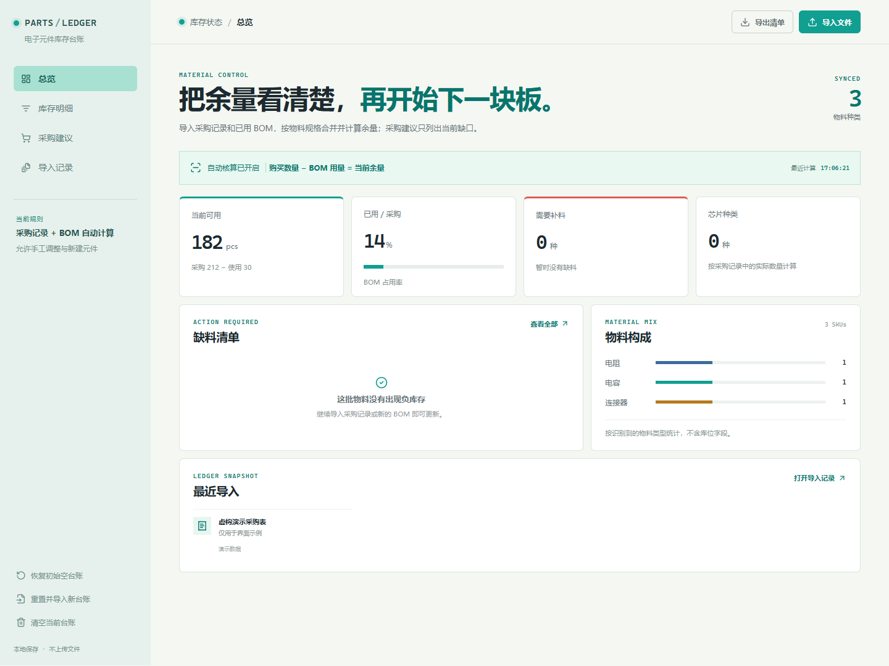

# 电子元件库存台账

在浏览器中管理电子元件采购、BOM 用量、库存余量和采购建议。可以构建为离线单文件 HTML，无需服务器或账号。

**[下载最新版](https://github.com/Greg-Street/electronic-components-ledger/releases/latest) · [使用指南](docs/GUIDE.md) · [问题反馈](https://github.com/Greg-Street/electronic-components-ledger/issues)**

## 界面预览



截图使用虚构演示数据；公开版本从空台账开始，不包含任何真实采购、价格、BOM 或项目记录。

## 功能

- 导入采购记录和已用 BOM，按立创编号及规格匹配物料。
- 查看采购、使用与剩余数量，搜索、分类和筛选库存。
- 导入新板 BOM，计算缺料并导出采购建议。
- 记录导入来源与库存调整，在浏览器本地保存台账。
- 单文件离线运行，也可通过 Windows 脚本创建独立浏览器窗口和桌面入口。

## 下载与使用

下载 [Releases](https://github.com/Greg-Street/electronic-components-ledger/releases/latest) 的离线包，解压后打开 `电子元件库存台账.html`。初始数据为空，请使用界面导入自己的记录。

采购记录、已用 BOM 和新板 BOM 分别从对应入口导入。导入新板 BOM 用于备料计划，不等于采购入库。详细说明见 [使用指南](docs/GUIDE.md)。

Windows 可运行包内 `scripts/create-desktop-shortcut.ps1` 创建入口；启动脚本使用独立浏览器配置目录，关闭应用窗口后会清理其浏览器进程。

## 从源码构建

需要 Node.js 20+：

```powershell
npm ci
npm run build
```

输出为根目录及 `dist/` 中的 `电子元件库存台账.html`。`npm run dev` 可用于开发。构建依赖不进入 Git 仓库。

## 数据与限制

台账保存在浏览器本地存储，不上传到服务器。浏览器、配置目录或文件位置发生变化时，可能无法读取旧数据；清理浏览器数据前请先导出备份。采购与 BOM 格式不同，导入前应核对预览，库存结果仍需与实物盘点交叉检查。

不要提交自己的采购表、BOM、台账导出、浏览器配置或原始截图。公开版只包含程序与空数据结构。

## 来源与许可

应用代码与界面为本工程实现，依赖 SheetJS、Lucide 与 Vite。各自的许可证与说明见 [NOTICE.md](NOTICE.md)。工程整体许可尚未指定，源码公开不代表替第三方授予额外权利。
